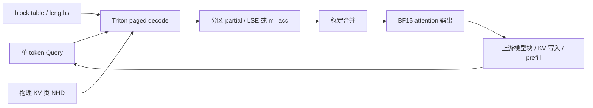
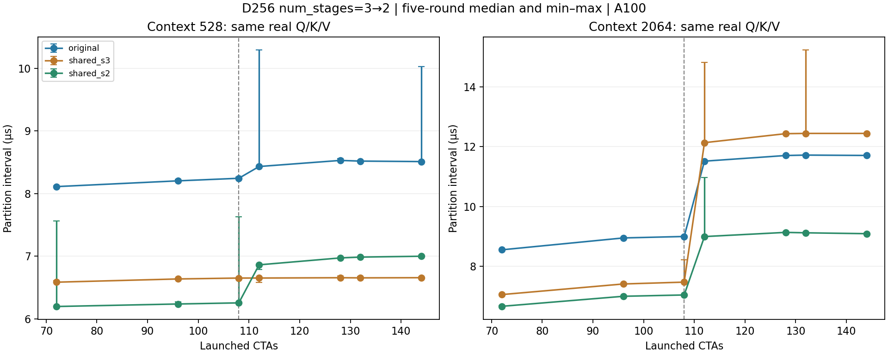

# Paged Decode Lab

**用 Triton 实现分页 Decode Attention，接入推理执行路径，并解释算子优化何时有效。**

大模型逐 token 生成时，attention 需要访问不断增长的 KV Cache。本项目研究如何通过 block table 读取非连续 KV 页、稳定地合并并行分区，以及如何在 CUDA Graph 中复用预分配资源。

你可以从无需 GPU 的 NumPy 示例理解算法，在 Linux CUDA 环境运行基础／split-K kernel，在固定版本 Qwen3.5 模型上比较自定义后端和 FlashAttention；还可以离线重算随仓库提供的历史性能统计。

这是求职展示与研究学习项目。**不声称从零编写整个推理引擎，也不声称全面超过 FlashAttention。**

## 主要成果与证据范围

- 实现 BF16、页大小 256、MHA/GQA、D64/128/256 的基础与 split-K decode attention；FP32 online softmax 累加，支持变长和零上下文。
- 在固定 nano-vLLM 基线上接入自定义 decode 后端；另外构建调用官方 Transformers 模型块的 Qwen3.5 固定 batch runner，支持 eager 和完整文本 decode forward 的 CUDA Graph。
- 追踪真实模型 token 分歧，定位分区、归一化 partial、LSE、log 和 FMA 的舍入协议；保留失败阶段，未放宽阈值。
- D256 实验将 shared kernel 的 `num_stages=3` 改为 `2`，降低资源占用，驱动允许的驻留上限从 1 恢复至 2 CTA/SM。
- 在固定 9B 真实激活、上下文 2064 的同轮对照中，完整算子提速约 **1.248×**；上下文 528 反而约慢 **2.44%**。两模型 Graph 端到端同轮比值中位数为 **0.9984–1.0015**，收益很小。

上述性能比较是本项目 `shared_s3` 与 `shared_s2` 的比较；不是相对 FlashAttention 的提速。结果来自历史 A100 实验，本次开源整理未重新启动 GPU 或模型。

[中文项目 PDF](docs/Paged_Decode_Lab_项目说明.pdf) · [架构](docs/ARCHITECTURE.md) · [复现](docs/REPRODUCE.md) · [真实迭代](docs/ITERATION_HISTORY.md) · [实验与负结果](docs/RESULTS.md) · [交付检查](docs/VALIDATION.md)

## 架构与运行流程



逻辑 token `t` 对应的物理页为 `table[b, t // 256]`，页内位置为 `t % 256`。GQA 查询头 `h` 对应 KV 头 `h // (Hq/Hkv)`。分区可以跨物理页，不能把 split 边界当成物理页边界。

基础版每个 CTA 处理一条序列的一个 query head；split-K 增加 KV 分区维度，先独立计算稳定 softmax 状态，再合并。workspace 在捕获前分配，编译和预热在 capture 前完成；replay 不通过读取 GPU 标量改变 Python 分支。

## 核心源码与入口

| 组件 | 源码 | 作用与边界 |
|---|---|---|
| 基础／固定 1024-token split-K | `src/paged_decode/kernels.py` | FP32 online softmax、分页寻址与稳定 merge |
| 资源与校验 | `runtime.py`、`spec.py` | 固定容量、预分配输出、外部元数据需单独校验 |
| 容量规划／数值对齐 | `splitkv_plan.py`、`matched_splitkv.py` | 固定 table 宽度，normalized partial + LSE |
| Qwen3.5 runner | `hybrid.py`、`hybrid_options.py` | 官方模型块，文本、单 GPU、固定无 padding batch |
| nano-vLLM 集成 | `overlays/nano-vllm/` | 在固定上游源码上重建；模型、调度等归上游 |
| 四状态实验 partition | `experimental_fragment_partition.py` | 归约顺序与 inline PTX，受布局预检约束 |
| 最新 D256 S2/S3 实验 | `tools/fragment_resident_common.py` | `original/shared_s3/shared_s2`，不是正式 CLI 选项 |
| 模型运行 CLI | `tools/qwen35.py` | 默认 `flash_attn`，可显式用 `triton_matched` |

表中省略目录前缀的 `.py` 均位于 `src/paged_decode/`。更多入口分级见 [工具说明](docs/TOOLS.md)。

## 最小运行：无需 GPU

**Windows PowerShell**，先进入解压后的项目根目录：

```powershell
$env:PAGED_CPU_TEMP_ROOT = Join-Path $HOME 'Documents\Codex\.cache\paged-cpu'
python -m venv .venv-cpu
if ($LASTEXITCODE -ne 0) { throw 'venv failed' }
& .\.venv-cpu\Scripts\python.exe -m pip install -e '.[test]'
if ($LASTEXITCODE -ne 0) { throw 'pip failed' }
& .\.venv-cpu\Scripts\python.exe examples/cpu_attention.py
if ($LASTEXITCODE -ne 0) { throw 'demo failed' }
& .\.venv-cpu\Scripts\python.exe release/rebuild_upstream.py
if ($LASTEXITCODE -ne 0) { throw 'upstream reconstruction failed' }
& .\.venv-cpu\Scripts\python.exe release/check_cpu.py
if ($LASTEXITCODE -ne 0) { throw 'CPU checks failed' }
& .\.venv-cpu\Scripts\python.exe release/verify_public_results.py
if ($LASTEXITCODE -ne 0) { throw 'evidence checks failed' }
```

**Linux 终端**，在项目根目录：

```bash
set -e
python3 -m venv .venv-cpu
.venv-cpu/bin/python -m pip install -e '.[test]'
.venv-cpu/bin/python examples/cpu_attention.py
.venv-cpu/bin/python release/rebuild_upstream.py
.venv-cpu/bin/python release/check_cpu.py
.venv-cpu/bin/python release/verify_public_results.py
```

上游重建默认下载固定 ZIP 并验证 SHA256；已有归档时使用 `--archive /path/to/baseline.zip` 离线重建。目标已存在会报错，避免覆盖。NumPy 示例和 CPU 检查没有执行 GPU kernel，也没有进行模型推理。

## GPU 与真实模型运行

需要 Linux、推荐 Python 3.11、兼容 CUDA 的 PyTorch／FlashAttention。固定依赖见 `requirements-qwen35.txt`。FlashAttention 可能需要匹配 ABI 的 wheel 或本地编译条件；源码完整不代表任意机器都能一键安装。

以下是**用户主动执行的 GPU 命令**，本次文档整理没有运行它们。在独立环境中安装依赖后，从项目根目录执行：

```bash
set -e
python tools/download_model.py --size small --output models/Qwen3.5-0.8B
python tools/download_model.py --size large --output models/Qwen3.5-9B
source tools/env.sh
python tools/qwen35.py --model models/Qwen3.5-0.8B \
  --backend triton_matched --mode graph --output results/demo-small-new
python tools/qwen35.py --model models/Qwen3.5-9B \
  --backend triton_matched --mode graph --output results/demo-large-new
```

输出目录必须不存在。模型不随仓库分发。`configs/models.json` 记录官方仓库、固定 revision、权重文件大小和 SHA256；本次整理未重下载或重哈希权重。下载可用性、模型上游许可需在使用时检查。

最新 S2 实验另运行 `tools/resident_experiment.py --task correctness/model`，性能入口为 `tools/benchmark_fragment_resident_models.py`，详见 [复现说明](docs/REPRODUCE.md)。不要给 `qwen35.py` 传入不存在的 `shared_s2` 后端。

## 实验设置与结果

历史主实验硬件为 A100-SXM4-80GB、sm80、108 SM；PyTorch 2.6.0、Triton 3.2.0、FlashAttention 2.7.4.post1、Transformers 5.3.0。两个模型使用固定官方 revision，full-attention D256；linear attention 沿用官方 Torch fallback，不能代表启用完整工业优化的 Qwen 服务。

| 上下文 | 完整算子 S3 中位数 µs | S2 中位数 µs | 同轮 S3/S2 比值中位数 |
|---:|---:|---:|---:|
| 528 | 10.7780 | 11.0369 | 0.9762，S2 退化 |
| 2064 | 16.6610 | 13.3474 | 1.2483，S2 获益 |

统计采用五轮独立重复和同轮配对比值。算子使用固定真实张量的 hot-cache 访问，包含 partition+merge，workspace 已预分配，不含模型层、KV 写入或 workspace 分配。480 条算子记录含多个 grid、两种 unroll；表格仅取完整 grid、unroll=128。不能把这个表解释成完整请求时延。



模型性能覆盖两模型、输入 512/2048、batch=1、输出64、四后端 × eager/Graph × 五轮，共160条。wall 与逐步 CUDA Event 分开采集，三组自定义 workspace 在所有后端中保留，峰值显存不是 native 的最小预算。

最新数值证据包括72项分页输出检查、每模型1920个自然／边界提示 logits steps及60次独立 greedy runs。固定模型性能输入还各做1024步 logits 对齐。逐位一致仅是这些版本、输入和设备上的观测，不能推广为任意输入保证。

早期基础／split-K 的固定模型回归存在 argmax 分歧；固定1024分区的 TC split-K 仍有9B长输入失败。后续匹配容量和 LSE 协议解决了已记录用例，失败结果没有被重命名为通过。[完整边界与负结果](docs/RESULTS.md)

## 迭代、公开范围与许可

[迭代历史](docs/ITERATION_HISTORY.md) 按模型／输入／工具／算法／评测发布分别说明变化和采用状态；没有用不同测试集成绩拼接提升曲线。

```text
src/              自定义 attention、runtime、Qwen3.5 适配
overlays/         固定上游的精确修改文件
patches/          原始上游补丁，保留字节
tests/            CPU 协议检查及需 GPU 的测试
examples/         明确标记的合成 CPU 示例
tools/            正式、实验和历史诊断入口
experiments/      必要算法快照，不是独立可运行旧版
evidence/         脱离主机信息的历史派生测量与汇总
provenance/       原字节哈希、来源映射和提取规则
release/          重建、验证、PDF 和手动上传工具
docs/             架构、实验、迭代、复现、PDF
```

[公开范围与剩余缺口](docs/PUBLIC_SCOPE.md) 区分代码、安装、模型下载、实验复现和生产能力。私有原始日志、大张量、GPU UUID、服务器路径和历史发布包不公开，也没有为它们编造下载链接。公开摘要明确标记为派生数据。

新增工作延用项目原有 MIT 许可证；nano-vLLM 保留 MIT 来源与版权。运行依赖、模型及参考算法各有上游许可，见 [THIRD_PARTY.md](THIRD_PARTY.md) 与 [来源映射](provenance/SOURCE_MAP.json)。使用 AI 辅助实现和整理；模型块、prefill、调度、权重加载等归上游，不能作为个人原创成果申报。

贡献前请说明修改范围、数值门槛和计时边界；不要覆盖历史证据或提交模型／凭据。[贡献说明](CONTRIBUTING.md)

GitHub由你手动创建和上传，见[Windows上传步骤](docs/GITHUB_UPLOAD.md)。
