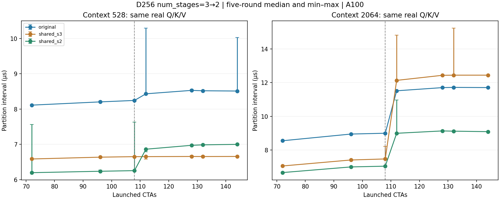

# D256 两阶段流水线：恢复双 CTA 驻留后的回归

> 复用远程历史报告，仅调整图片路径。原始日志、快照与监控保留私有；公开派生数据见 ../evidence/，公开范围见 PUBLIC_SCOPE.md。此报告不代表本次重新运行GPU。

唯一手动变化是 shared kernel 的 `num_stages=3→2`；MMA layout、四状态 PTX 归约、分页布局、split 计划、BF16/FP32 数值协议和 merge 均不变。保留 original、shared_s3、shared_s2 三条显式实验路径。

## 结论

目标长上下文 2064 上，shared_s3/shared_s2 的同轮比值中位数为：partition 1.3686×，完整算子 1.2483×；完整算子相对 original 为 1.1819×。恢复双 CTA 驻留后，原先约 6% 的 partition 退化被消除。

短上下文 528 的完整算子存在约 2.44% 延迟增加，五轮范围见表。它与短上下文非空 CTA 较少、资源门槛收益有限的现象一致；没有硬件计数器单独证明具体访存隐藏或调度原因。因此保留两个显式实验配置，未做全局自动选择或默认替换。

两模型、两长度的 Graph wall 旧版/新版同轮比值中位数为 0.9984–1.0015。模型收益应按这些独立 wall 数据判断，不能直接套用 kernel 提速。

## 资源与正确性

| 版本 | dynamic shared B | static shared B | 寄存器/线程 | spill 字段 | 驱动最大 CTA/SM |
|---|---:|---:|---:|---:|---:|
| original | 79232 | 0 | 255 | 16 | 2 |
| shared_s3 | 79232 | 4352 | 255 | 8 | 1 |
| shared_s2 | 77952 | 4352 | 192 | 0 | 2 |

shared_s2 每 CTA 总 shared 预留为 77952+4352+1024=83328 B，两个为 166656 B，低于每 SM 的 167936 B；驱动查询确认可驻留两个 CTA。
寄存器和 spill 字段也随编译调度变化，不能把全部性能变化单独归因于 shared 容量或 occupancy。没有新增 achieved occupancy 或动态 spill 流量的硬件计数器声明。

original/shared_s3 控制路径在本轮显式按三阶段重新编译。离线核验发现其 .text 与早先存档不逐字节相同；未将差异归因于某个未验证的编译因素。所有速度比都取本轮配对，不跨 campaign 比绝对延迟；原／新 .text 指纹见 summary.json。原 kernel 源码及历史产物保持不变。

分页回归沿用原 D256 suite：MHA/GQA、三种 head 几何、自动／单分区、四轮状态更新、零长度、NaN padding、无效页与跨页增长。72 项输出通过 FP32 参考（atol/rtol=.02）与 Graph/eager 对照；非空行另外对照 native，全空输出必须严格为零；三版本的输出、partials、LSE 均逐字节一致。
两模型均重跑原有 8 个真实提示和 255／1023 边界提示，native／original／shared_s2 × eager/Graph；每模型 1920 个完整 logits 步和 60 次 free greedy 通过。原 suite 中标签 shared 在本轮明确映射为 shared_s2，映射与源码哈希写在 resident-experiment.json。

## 真实张量的算子和 grid 对照

使用先前保存的 9B layer 3 实际 Q/K/V，上下文 528／2064，容量 2112、36 splits。480 项计时：三版本 × 两上下文 × 七个 partition grid 和完整算子 × 两种 unroll × 五轮。
每项 capture 32／128 次调用，replay 20 次；主表为 unroll=128 的五轮中位数，比例为同轮配对值的五轮中位数。完整算子包括 partition+merge，不含 workspace 分配或 snapshot 拷贝；同张量重复访问属于 hot-cache 诊断。



| 上下文 | stage | original µs | shared_s3 µs | shared_s2 µs | s3/s2（范围） | original/s2 |
|---|---|---:|---:|---:|---:|---:|
| 528 | partition | 8.5111 | 6.6558 | 6.9987 | 0.9527 (0.9491–0.9540) | 1.2161 |
| 528 | full | 12.7406 | 10.7780 | 11.0369 | 0.9762 (0.9755–0.9789) | 1.1544 |
| 2064 | partition | 11.7030 | 12.4406 | 9.0885 | 1.3686 (1.3649–1.3695) | 1.2875 |
| 2064 | full | 15.7808 | 16.6610 | 13.3474 | 1.2483 (1.2468–1.2487) | 1.1819 |

unroll 中位数差异超过 3% 的控制数：0。全部逐轮数据与 grid 结果保留，未丢弃尾值。

## 同轮模型 wall 对照

固定 revision Qwen3.5-0.8B／9B，batch=1，输入 512／2048，输出 64 tokens，容量 2112。四后端 × eager/Graph × 两长度 × 五轮，每模型 80 项。
正式 wall 调用无逐步 events；另一次生成收集 63 个 decode event 区间。JIT、capture、warmup 和 profiling 均不计入正式 wall。每配置先检查 64 步完整 logits 字节对齐和独立 free greedy，所有计时 token 也必须对齐。
三组预分配 workspace 在所有后端中保留，显存是固定实验预算下的 allocated peak，不能解释为 native 的最小显存。两模型各用一张独占空闲 GPU，CPU／主机共享。沿用官方 Transformers Torch 线性 attention fallback。

| 模型 | 输入 | mode | native s | original s | shared_s3 s | shared_s2 s | s3/s2（同轮范围） |
|---|---:|---|---:|---:|---:|---:|---|
| Qwen3.5-0.8B | 512 | eager | 2.237203 | 2.330830 | 2.316012 | 2.317032 | 1.0005 (0.9992–1.0055) |
| Qwen3.5-0.8B | 512 | graph | 0.535700 | 0.534120 | 0.533483 | 0.533876 | 0.9985 (0.9978–1.0020) |
| Qwen3.5-0.8B | 2048 | eager | 2.359847 | 2.459441 | 2.446943 | 2.437750 | 1.0040 (0.9971–1.0078) |
| Qwen3.5-0.8B | 2048 | graph | 0.662284 | 0.659289 | 0.658866 | 0.658883 | 0.9984 (0.9940–1.0056) |
| Qwen3.5-9B | 512 | eager | 3.295355 | 3.283704 | 3.445759 | 3.292050 | 1.0396 (0.9942–1.0743) |
| Qwen3.5-9B | 512 | graph | 1.280030 | 1.276180 | 1.275580 | 1.275467 | 1.0015 (0.9958–1.0018) |
| Qwen3.5-9B | 2048 | eager | 3.351373 | 3.488831 | 3.557064 | 3.508043 | 1.0049 (0.9969–1.0563) |
| Qwen3.5-9B | 2048 | graph | 1.463646 | 1.460211 | 1.460266 | 1.457982 | 1.0015 (1.0000–1.0034) |

TPS、decode event 中位数、allocated peak、各轮 min/max 和全部配对比值保存在 summary.json；不能用单个算子提速比例代替模型吞吐比例。eager 部分配置的波动较大，不能把单个中位数当成稳定的模型提速证据。生产 kernel、公共默认后端和以往结果均不改动。

## 复现

```bash
CUDA_VISIBLE_DEVICES=0 python tools/resident_experiment.py --task correctness --output /tmp/new-correct
CUDA_VISIBLE_DEVICES=0 python tools/resident_experiment.py --task benchmark --output /tmp/new-operator
CUDA_VISIBLE_DEVICES=0 python tools/resident_experiment.py --task model --model models/Qwen3.5-0.8B --output /tmp/new-model
CUDA_VISIBLE_DEVICES=0 python tools/benchmark_fragment_resident_models.py --model models/Qwen3.5-0.8B --output /tmp/new-perf
```

输出目录必须不存在，成功后立即归档。实测使用持久 ZIP 检查点；checkpoint 写入只发生在同步和 GPU guard 之后，不在计时区间内。每个数据集保留 UUID、监测、配置、源码快照及退出记录。
